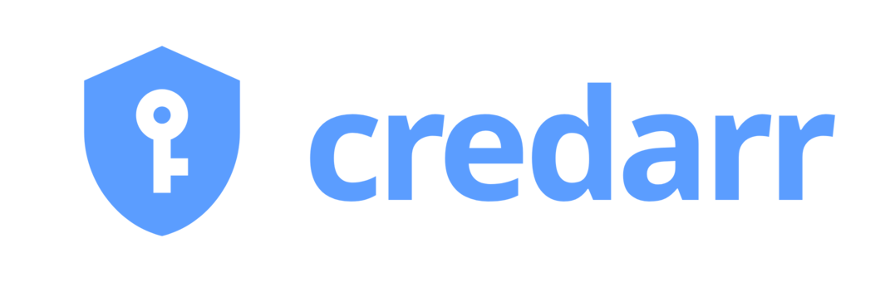
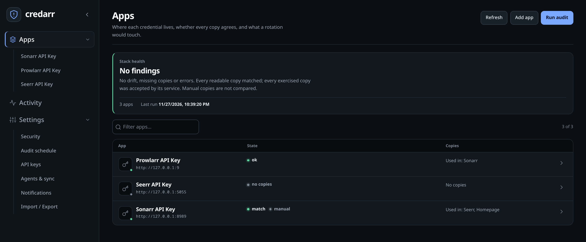

<p align="center">
  
</p>

<h3 align="center">Audit and rotate API keys across your self-hosted stack</h3>

<p align="center">
  <a href="https://github.com/ezcodelab/credarr/actions/workflows/ci.yml"></a>
  <a href="https://github.com/ezcodelab/credarr/releases"></a>
  <a href="https://github.com/ezcodelab/credarr/pkgs/container/credarr"></a>
  <a href="https://github.com/ezcodelab/credarr/blob/main/LICENSE"></a>
</p>

<p align="center">
  
</p>

## Overview

Credarr maps each API key to the service that issues it and every app that holds
a copy. It audits those copies over the service's own API and rotates the keys
it can prove. The console and the CLI use one engine, so they report the same
findings and refuse the same rotations.

## Features

### Audit

- Map a credential to its issuer and to every declared copy.
- Compare every readable copy over the service API. Report `match`, `live`,
  `drift`, `manual`, `unverifiable` and `missing` in their own words.
- Read no config files, host binds or data volumes.

### Rotate

- Plan before writing. The planner refuses a rotation it cannot finish, and
  preflight runs before anything is minted.
- Rotate the key, write and verify each holder, then revoke the old key last.
- Resume or abandon an interrupted run. Credarr never reruns one by itself.
- Opt for auto-rotation per credential. It runs only on a clean audit, and a
  manual copy is named in the notification instead of blocking the stack.

### Operate

- Apps, app detail, Activity, rotation plans, notifications and import/export
  in one console.
- Encrypt values with AES-256-GCM under a per-version key. Values are write-only
  except for an audited Reveal.
- Deliver values to compose stacks through an optional mTLS agent. Docker stays
  on the agent and never enters the console.
- Back up the database and the key encryption key into one encrypted file.
- Notify ntfy, webhook, Discord, Telegram and SMTP.

## Getting Started

### Requirements

- A Docker host with network access to the services you want to audit.
- A URL and an API key per service.
- A supervisor that restarts Servarr apps. The LinuxServer s6 images work. A
  bare process does not.
- Python 3.11+ for the CLI, or Node 24+ to build the console from source.

### Production

```yaml
services:
  credarr:
    image: ghcr.io/ezcodelab/credarr:latest
    container_name: credarr
    restart: unless-stopped
    ports:
      - "8080:8080"
    environment:
      PUID: "1000"
      PGID: "1000"
      TZ: Etc/UTC
      CREDARR_AUDIT_INTERVAL: "3600"
    volumes:
      - ./config:/config
```

Open `http://localhost:8080` and create the admin password. Behind TLS, set
`CREDARR_EXTERNAL_URL=https://credarr.example.com`. The `https` scheme enables
secure cookies. Leave it unset for plain HTTP.

Pin `ghcr.io/ezcodelab/credarr:2.0.0` for a fixed version. The console and agent
images publish the same tags.

### Configuration

| Variable | Default | Description |
| --- | --- | --- |
| `PUID` / `PGID` | `1000` | User and group the app runs as. |
| `TZ` | `Etc/UTC` | Timezone for logs and console timestamps. |
| `CREDARR_CONFIG_DIR` | `/config` | Directory that holds `app.db`. |
| `CREDARR_AUDIT_INTERVAL` | `3600` | Initial seconds between audits. A saved setting wins. |
| `CREDARR_EXTERNAL_URL` | unset | Public URL. An `https` value enables secure cookies. |
| `CREDARR_SECURE_COOKIES` | unset | Set to `1` behind HTTPS. |
| `CREDARR_AGENT_PORT` | `8443` | mTLS listener port for agents. `0` disables it. |
| `CREDARR_AGENT_HOSTNAME` | unset | Name agents use for the console. Added to the listener certificate. |
| `CREDARR_VAULT_TREE` | unset | Shared delivery tree. Required before creating a sync target. |
| `CREDARR_VAULT_TREE_KEY` | `<config>/vault-tree.key` | Key file for the shared tree. Keep it outside the tree. |
| `CREDARR_AGENT_CA_CERT` | unset | Bring-your-own CA certificate. Pair it with the key. |
| `CREDARR_AGENT_CA_KEY` | unset | Key for the brought CA. |
| `CREDARR_DOCKER_URL` | unset | Optional read-only Docker API for discovery. Never mount the raw socket. |

### Docker delivery agent

Audit and rotation work without an agent. The optional agent updates a stack's
env file or restarts declared services after a rotation.

The agent is its own image, `ghcr.io/ezcodelab/credarr-agent`. The console
listens on `CREDARR_AGENT_PORT` (default `8443`). Set `CREDARR_AGENT_HOSTNAME`
to the name agents use, enroll from Settings > Agents & sync, and download
`agent-ca.crt`. The agent reads the shared tree key (`CREDARR_VAULT_TREE_KEY`)
and the CA from Docker secrets, and reaches Docker through a socket proxy. To
bring your own CA, set `CREDARR_AGENT_CA_CERT` and `CREDARR_AGENT_CA_KEY`.

The full compose for the agent, the socket proxy and the shared tree is in
[`docs/SYNC.md`](docs/SYNC.md).

## CLI

```sh
pip install .
credarr targets
credarr audit
credarr rotate prowlarr_api_key
credarr rotate prowlarr_api_key --apply
```

Use `pip install -e ".[dev]"` for a development install. The CLI reads
`credarr.yaml`. The console keeps its topology in `app.db` and needs no manifest.

## Development

You need Python 3.11+, Node 24+ and Docker for the container tests.

```sh
make install
make serve      # console on http://127.0.0.1:8080
make ui-dev     # Vite dev server against the console
make check      # lint, Python tests, UI tests and UI audit
make ui-smoke   # build the console and drive it in Chromium
```

See [`docs/CONTRIBUTING.md`](docs/CONTRIBUTING.md) for conventions and the merge
gate.

## Documentation

- [Concepts](docs/CONCEPTS.md): holder map, audit statuses, classes and exit codes.
- [Operating](docs/OPERATING.md): audits, rotation, values, agents and backups.
- [Security](docs/SECURITY.md): threat model, crypto and key lifecycle.
- [Sync](docs/SYNC.md): agent enrollment, targets and the shared tree.
- [Services](docs/SERVICES.md): measured per-service coverage.
- [All documentation](docs/README.md)
- [Changelog](CHANGELOG.md)

## Support

Read the documentation before opening an issue. Bug reports and feature
requests go to [GitHub Issues](https://github.com/ezcodelab/credarr/issues).
Do not paste real API keys or hostnames into an issue.

## License

Apache-2.0. See [LICENSE](LICENSE).
