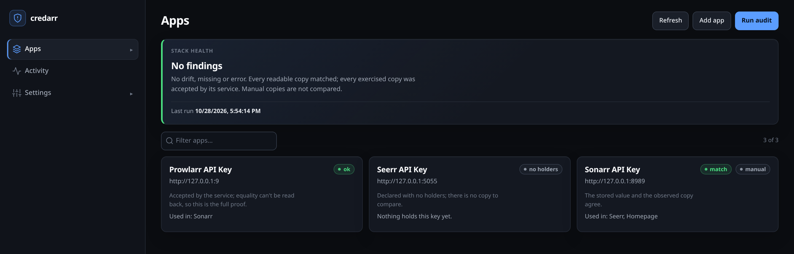
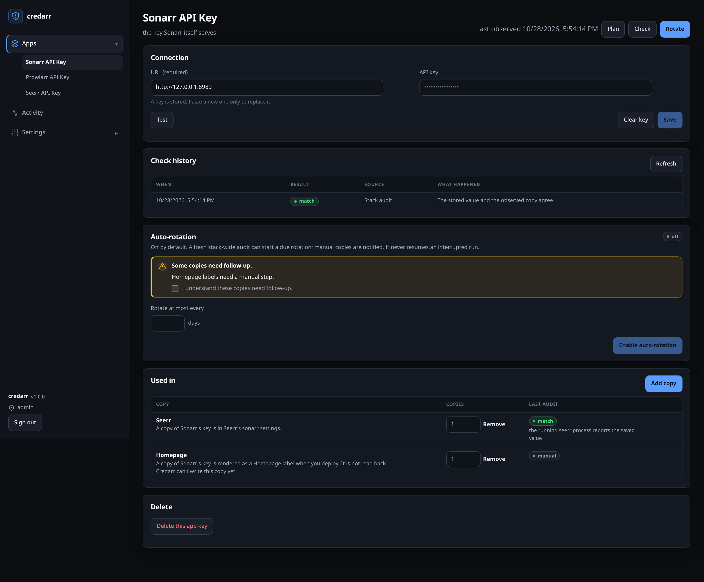
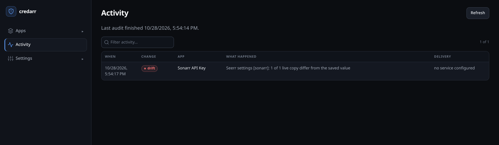

<p align="center">
  
</p>

**Find out which of your services hold each API key, whether the copies still match, and what can actually be rotated. Then rotate it.**



Credarr keeps a holder map, audits every readable copy against the canonical value, and rotates the keys it can prove.

## What it does

- **Audit** every declared credential against what its holders actually serve. Drift, unverifiable, absent and manual copies are reported in their own words. Never a silent skip.
- **Plan, then rotate.** A planner that refuses what it cannot deliver, preflight that fails before anything is minted, per-holder propagation with verification, and an encrypted journal so an interrupted run can be resumed. Never blindly re-run.
- **A console, not a CLI skin.** Apps, per-app check history, rotation plans, auto-rotation, notifications and import/export in one SPA over the same engine the CLI uses.
- **Opt-in auto-rotation** per credential, gated on a fresh clean audit. A copy that needs a human is named in an `auto_manual` notification instead of freezing the whole stack.
- **Notifications**: ntfy, webhook, Discord, Telegram and SMTP email. Events are status changes, never values.
- **Encrypted backups** of `app.db` (every working copy) in one AES-256-GCM file.

### The console





Values are write-only in the browser: a paste is sent once, the field is emptied, and no response echoes it. Nothing secret is kept in local storage.

## Requirements

- A Docker host (or any Linux host for the CLI) with network access to the services you want to audit.
- A URL and an API key per service. Credarr calls service APIs; it never reads a service's config file or data volume.
- Rotating a Servarr key asks the service to restart itself, so that service needs a supervisor that starts it again (for example the LinuxServer s6 images). A bare process without one is not supported.
- CLI only: Python 3.11+.
- Building the console from source: Node 24+.

## Quick start (Docker Compose)

```
services:
  credarr:
    image: ghcr.io/ezcodelab/credarr:latest
    container_name: credarr
    restart: unless-stopped
    ports:
      - "8080:8080"
    environment:
      PUID: "1000"
      PGID: "1000"
      TZ: Etc/UTC
      CREDARR_AUDIT_INTERVAL: "3600" # Initial seconds between audits. A value saved in Settings wins.
      # CREDARR_DOCKER_URL: "http://socket-proxy:2375" # Optional read-only Docker discovery.
    volumes:
      - ./config:/config
```

### Docker settings

| Variable | Default | Meaning |
| --- | --- | --- |
| `PUID` / `PGID` | `1000` | The uid/gid the app runs as. The entrypoint starts as root, aligns the app user and `/config`, then drops to it with `gosu`. Under `--user` they are ignored. |
| `TZ` | `Etc/UTC` | Timezone for server logs and every console timestamp (the browser's zone is not used). |
| `CREDARR_CONFIG_DIR` | `/config` | Where `app.db` lives. |
| `CREDARR_AUDIT_INTERVAL` | `3600` | Initial seconds between audits; a value saved in Settings wins. |
| `CREDARR_ALLOW_NETWORK_CONFIG` | unset | `1` accepts a network `/config`. This weakens SQLite locking and is not HA support. |
| `CREDARR_DOCKER_URL` | unset | Optional read-only Docker API for discovery, e.g. `http://socket-proxy:2375`. Never mount the raw socket. |
| `CREDARR_SECURE_COOKIES` | unset | `1` marks the session cookie `Secure`. Set it behind HTTPS only. |
| `CREDARR_EXTERNAL_URL` | unset | The URL people reach the console on. `https` turns secure cookies on; a contradiction with the variable above refuses to start. |

Behind a TLS proxy set `CREDARR_EXTERNAL_URL=https://...`. Leave both unset for plain HTTP: a `Secure` cookie is dropped by the browser and sign-in fails. The server warns at startup when secure cookies are off and it binds a non-loopback address.

### Run-once (cron)

```sh
credarr-server --once --config /config/credarr.yaml --config-dir /config --json
```

Audits the app's own store, prints the CLI's JSON document and exits with the CLI's code. It also ticks the notifier once, so a cron-only deployment is still a monitor.

## CLI

```sh
pip install .
# or, for development
pip install -e ".[dev]"

cp credarr.example.yaml credarr.yaml   # hosts, service URLs, manifest path
credarr targets                        # every target this build can read
credarr audit                          # check every declared credential
credarr rotate prowlarr_api_key        # plan only; nothing changes
credarr rotate prowlarr_api_key --apply  # typed confirmation, then run
```

## Documentation

| Page | What it is |
| --- | --- |
| [`docs/README.md`](docs/README.md) | Documentation index |
| [`docs/CONCEPTS.md`](docs/CONCEPTS.md) | Holder map, audit statuses and reason codes, classes, exit codes |
| [`docs/ARCHITECTURE.md`](docs/ARCHITECTURE.md) | Engine / server / console layout and invariants |
| [`docs/OPERATING.md`](docs/OPERATING.md) | Audit, rotation, Servarr routes, auto-rotation, notifications, backups, discovery |
| [`docs/SERVICES.md`](docs/SERVICES.md) | Per-service coverage and the measured versions |
| [`docs/API.md`](docs/API.md) | `/api/v1` reference (full contract: the live `/openapi.json`) |
| [`docs/LIMITATIONS.md`](docs/LIMITATIONS.md) | Known limits and troubleshooting |
| [`docs/TESTING.md`](docs/TESTING.md) | Test layers, gaps and the rules for new tests |
| [`docs/CONTRIBUTING.md`](docs/CONTRIBUTING.md) | Toolchain, checks, conventions |
| [`docs/ADDING_A_SERVICE.md`](docs/ADDING_A_SERVICE.md) | Lifecycle checklist for new service support |
| [`CHANGELOG.md`](CHANGELOG.md) | Release notes |

## License

Apache-2.0 (see [LICENSE](LICENSE)).
